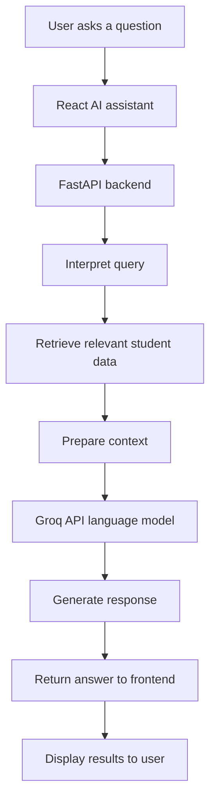
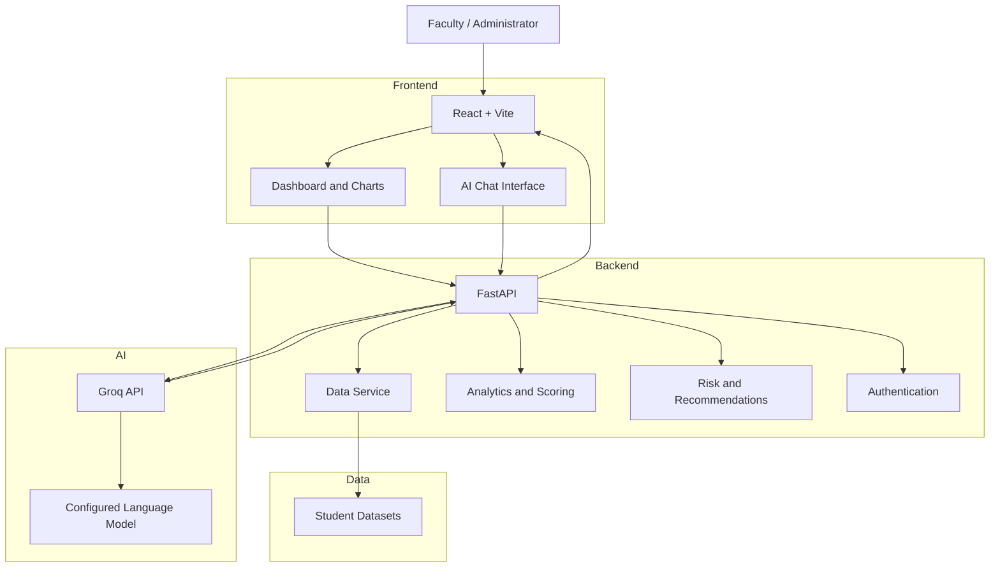

# 🎓 AcademiaAI — AI-Powered Student Analytics and Success Platform

**Turning student data into actionable insights with AI, analytics, and intelligent student support.**

<p align="center">
  <strong>Understand Student Performance · Identify Risks · Improve Student Success</strong>
</p>

AcademiaAI is an AI-powered student analytics platform designed to help educational institutions understand student performance, identify potential learning challenges, monitor engagement, and improve placement readiness.

The platform unifies academic records, attendance, learning management system (LMS) activity, engagement, technical skills, feedback, and placement information into a centralized analytics system.

Its key highlight is the integration of an **AI-powered chat assistant using the Groq API**. Users can ask questions about student analytics in natural language and explore relevant student information without manually searching through multiple datasets. The platform combines AI-assisted data exploration with transparent scoring rules, risk indicators, and actionable recommendations to support better-informed decisions.

🔗 **Live Demo:** https://academia-ai-ten.vercel.app  
🔗 **Backend API:** https://academiaai-api.onrender.com  
🔗 **API Documentation:** https://academiaai-api.onrender.com/docs  
🔗 **GitHub Repository:** https://github.com/seerakirankumar/AcademiaAi

---

## 📚 Table of Contents

1. [Project Overview](#-project-overview)
2. [Problem Statement](#-problem-statement)
3. [Our Solution](#-our-solution)
4. [Key Features](#-key-features)
5. [AI Implementation](#-ai-implementation)
6. [AI Assistant Workflow](#-ai-assistant-workflow)
7. [Student Success Score](#-student-success-score)
8. [Risk Detection and Recommendations](#-risk-detection-and-recommendations)
9. [How the Platform Works](#-how-the-platform-works)
10. [System Architecture](#-system-architecture)
11. [Technology Stack](#-technology-stack)
12. [Dataset Information](#-dataset-information)
13. [Project Structure](#-project-structure)
14. [Installation and Setup](#-installation-and-setup)
15. [Environment Variables](#-environment-variables)
16. [Running the Application](#-running-the-application)
17. [API Documentation](#-api-documentation)
18. [Deployment](#-deployment)
19. [Security and Privacy](#-security-and-privacy)
20. [Testing and Validation](#-testing-and-validation)
21. [Current Limitations](#-current-limitations)
22. [Future Enhancements](#-future-enhancements)
23. [Disclaimer](#-disclaimer)
24. [Contributors](#-contributors)
25. [Author](#-author)
26. [License](#-license)

---

## 🚀 Project Overview

Educational institutions generate large amounts of student information, but that information is often distributed across different systems and datasets.

AcademiaAI brings these sources together to provide a more comprehensive view of student progress. It helps faculty and administrators examine performance trends, identify potential challenges, understand skill gaps, and explore placement readiness.

The platform combines three major capabilities:

- **Data analytics:** Transforms student records into dashboards, charts, and performance indicators.
- **Rule-based intelligence:** Calculates configurable success scores, identifies risk indicators, and generates structured recommendations.
- **AI-assisted analytics:** Uses a Groq-powered language model to help users explore student information through natural-language questions.

The goal is to move beyond simply displaying student data and make that data easier to understand and act upon.

## ❗ Problem Statement

Traditional student monitoring often relies on examination results and attendance records alone. These indicators may not reveal the complete picture of a student's academic journey.

Important information can be distributed across:

- Academic performance and CGPA records.
- Attendance and assignment completion.
- LMS activity and learning hours.
- Technical and soft skills.
- Extracurricular activities and engagement.
- Placement preparation and interview performance.
- Student feedback and requests for support.

Without a unified analytics platform, identifying patterns across these sources can be difficult and time-consuming.

Institutions need a system that makes relevant information accessible, highlights potential concerns, and helps educators provide timely support.

## 💡 Our Solution

AcademiaAI combines multiple student data sources into a unified analytics platform with AI-assisted exploration.

The platform enables users to:

- Monitor institutional and individual student performance.
- Explore attendance, academics, engagement, skills, and placements.
- Calculate configurable student success scores.
- Identify potential academic and placement risks.
- Ask natural-language questions through the AI assistant.
- Discover students matching particular criteria, such as a technical skill.
- Generate recommendations for tutoring, mentoring, and placement preparation.
- Organize intervention records and follow-up activities.

---

## ✨ Key Features

### 1. 📊 Student Analytics Dashboard

A centralized dashboard that summarizes important institutional and student-level indicators.

- Student population overview.
- Academic performance and CGPA analysis.
- Attendance and assignment completion insights.
- LMS activity and engagement metrics.
- Technical skill indicators.
- Placement readiness and placement outcomes.
- Interactive charts and visual summaries.

### 2. 🎯 Student Success Score

Calculates a configurable student success score on a scale of 0–100 using available performance indicators.

The current preliminary weighting configuration is:

| Indicator | Weight |
|---|---:|
| Academic performance | 40% |
| Attendance | 20% |
| LMS activity | 15% |
| Placement readiness | 25% |
| **Total** | **100%** |

The scoring implementation can account for missing inputs by reweighting available components when sufficient information exists.

If the available information is insufficient, the system should avoid presenting an unreliable score as definitive.

These weights are prototype assumptions and should be validated with educators before real-world use.

### 3. 🚦 Student Risk Indicators

Highlights students who may benefit from additional academic or placement support.

Potential indicators include:

- Low academic performance.
- Attendance concerns.
- Limited learning activity.
- Incomplete assignments.
- Skill gaps.
- Placement preparation challenges.

Risk indicators should be interpreted as prompts for further investigation, not definitive judgments about a student.

### 4. 🤖 AI-Powered Student Analytics Assistant

The platform integrates a language model through the Groq API to support natural-language exploration of student information.

Users can ask questions instead of manually navigating datasets and filtering records.

Example questions include:

- "Give me 10 students who have Git skills."
- "Which students may need academic support?"
- "Summarize student attendance and academic performance."
- "Find students who need placement preparation."
- "Explain the main factors contributing to student risk."
- "Show relevant student information for a particular skill."

The assistant is designed to combine the user's question with relevant application data and return a readable response.

**Important:** The quality and correctness of answers depend on the available datasets, the backend's retrieval and filtering logic, the model's response, and the validation performed by the application.

### 5. 🧠 Intelligent Recommendations

Provides structured recommendations based on available student indicators and configured rules.

Examples include:

- Academic tutoring for students with low performance.
- Attendance follow-up for students with attendance concerns.
- Mentoring for students requiring additional guidance.
- Technical skill development for students with identified gaps.
- Interview preparation and placement training.

Recommendations are intended to support human decision-making rather than replace it.

### 6. 🎓 Student and Placement Insights

Supports the exploration of student skills, placement preparation, and relevant performance information.

The combined datasets help users understand student readiness beyond examination marks alone.

### 7. 🔐 Authentication and Access Control

The backend includes authentication-related functionality intended to protect application endpoints and support controlled access.

The deployment must have secure production credentials, appropriate role permissions, and correctly configured environment variables.

### 8. 📈 Data-Driven Decision Support

Combines dashboards, scores, risk indicators, recommendations, and AI-assisted queries into a single workflow for understanding student outcomes.

---

## 🤖 AI Implementation

AI integration is one of the main technical components of AcademiaAI.

Rather than using a language model as a standalone chatbot, the platform connects an AI assistant to the backend analytics workflow so that questions can be interpreted in the context of relevant student information.

### AI technology used

| Component | Technology / Responsibility |
|---|---|
| AI inference provider | Groq API |
| Language model | Configurable through `GROQ_MODEL` |
| Example model configuration | `openai/gpt-oss-120b` |
| AI integration | Python backend |
| Application API | FastAPI |
| Data access | Backend data service and dataset-specific query logic |
| User interface | React/Vite frontend |
| Output | Natural-language explanations and answers |

The model shown above is the example configured in `.env.example`. The actual deployed model depends on the environment configuration.

### 1. Natural-language question processing

Users submit questions through the AI assistant interface.

For example:

> "Give me 10 students who have Git skills."

The backend processes the question to identify the requested information, such as:

- The relevant student dataset.
- The skill or attribute being searched.
- The requested number of results.
- Any student-related constraints.

The question can then be handled using the application's data-query logic.

### 2. Relevant student data retrieval

The backend contains data-service and query logic for working with student datasets.

For a skill-based question, the application can search the student skills data, identify matching skill records, and associate relevant results with student information.

This step is important because a language model alone does not automatically have access to private application datasets.

The application must explicitly retrieve the relevant records and make the appropriate context available to the assistant.

### 3. Groq API integration

The Groq API provides access to the configured language model for AI inference.

The backend uses the configured model and API credentials to process AI requests.

The API key belongs on the backend and must never be exposed in frontend source code.

Example configuration:

```env
GROQ_API_KEY=your_groq_api_key
GROQ_MODEL=openai/gpt-oss-120b
GROQ_TIMEOUT_SECONDS=45
```

Use the timeout variable only if it is supported by the backend configuration. The exact variable names must match the implementation in the deployed version.

### 4. Context-aware answer generation

After the application identifies the relevant information, the assistant can use the supplied context to produce a readable response.

For example, instead of returning raw CSV rows, the assistant can help present the requested student information in a clearer format.

Depending on the query and the implementation, responses may include:

- Matching student information.
- Summaries of relevant indicators.
- Explanations of available analytics.
- Suggested areas for further investigation.

The assistant should not invent student records, skills, marks, or placement outcomes. Data-dependent answers must be checked against the underlying records.

### 5. Integration with analytics

The AI assistant complements the platform's analytics rather than replacing its calculations.

For example:

- The scoring service calculates the configured success score.
- Risk logic evaluates configured risk conditions.
- Recommendation logic generates structured suggestions.
- The AI assistant helps users ask questions and understand relevant results.

This separation helps keep numerical calculations and configured rules distinct from language-model-generated explanations.

### AI implementation: What it does and does not mean

AcademiaAI's AI integration should be described accurately:

| Capability | Description |
|---|---|
| Language-model inference | Uses the configured Groq API model |
| Natural-language queries | Allows users to ask questions conversationally |
| Data-aware assistance | Uses backend query logic to retrieve relevant student information |
| Analytics explanations | Helps explain supplied context in natural language |
| Rule-based scoring | Uses configured application logic, not automatically an ML prediction |
| Predictive machine learning | Requires a separately implemented and validated predictive model; it should not be claimed solely because an LLM is integrated |

**AI implementation highlight:** AcademiaAI combines a language-model assistant with application-side data retrieval and analytics logic. This makes student information easier to explore while keeping scoring and risk calculations under the control of the backend.

---

## 🔄 AI Assistant Workflow

The following diagram illustrates the intended request flow for data-aware AI queries.



The exact execution path can vary by question type. Deterministic data queries and calculations should remain in application code wherever possible.

## 🎯 Student Success Score

The success score is a configurable indicator designed to summarize selected student performance dimensions.

The current prototype weighting is:

\[
S = 0.40A + 0.20T + 0.15L + 0.25P
\]

Where:

- \(S\) = student success score.
- \(A\) = normalized academic performance.
- \(T\) = normalized attendance.
- \(L\) = normalized LMS activity.
- \(P\) = normalized placement readiness.

Each component must use a consistent 0–100 scale before applying the weights.

This formula describes the intended weighted calculation. The implementation must normalize the component values and handle missing data consistently.

The score is a decision-support indicator, not a guarantee of future academic or placement success.

## 🚦 Risk Detection and Recommendations

The platform uses configured risk rules and available student indicators to identify situations that may require further attention.

A typical workflow is:

1. Load available student records.
2. Examine academic, attendance, LMS, engagement, skill, or placement indicators.
3. Apply the configured scoring and risk rules.
4. Identify potential concerns.
5. Generate relevant recommendations.
6. Allow faculty or administrators to review the results.

Risk rules and recommendations should be transparent, configurable, and reviewed periodically.

The platform should not automatically penalize students or make high-impact academic decisions solely on the basis of a score or AI-generated response.

## ⚙️ How the Platform Works

1. **Data loading:** The backend loads the configured student datasets.
2. **Data processing:** The data service prepares records for analytics and queries.
3. **Analytics calculation:** Application logic computes configured scores and indicators.
4. **Risk assessment:** The risk service evaluates configured conditions.
5. **Recommendations:** Recommendation logic generates possible support actions.
6. **AI assistance:** Natural-language queries are processed through the backend and, where appropriate, the configured Groq model.
7. **Visualization:** The frontend presents metrics, charts, student information, and AI responses.
8. **Human review:** Faculty and administrators assess the information and decide on appropriate next steps.

---

## 🏗️ System Architecture

AcademiaAI uses a frontend/backend architecture.



The architecture separates presentation, data access, analytics, authentication, and AI integration.

The AI provider is an external service. Requests requiring the language model depend on valid credentials, network connectivity, provider availability, and the configured model.

## 🛠️ Technology Stack

| Category | Technology |
|---|---|
| Frontend | React |
| Frontend tooling | Vite |
| Frontend language | TypeScript / JavaScript, as used by the application |
| Charts | Recharts |
| Icons | Lucide React |
| Backend | Python |
| Backend framework | FastAPI |
| API server | Uvicorn |
| AI inference | Groq API |
| Language model | Configurable through environment variables |
| Data processing | Python data-service and analytics logic |
| Data sources | CSV-based student datasets |
| Frontend deployment | Vercel |
| Backend deployment | Render |
| Version control | Git and GitHub |

Additional libraries may be used by the application. The repository's dependency files are the authoritative source for the exact installed versions.

---

## 📂 Dataset Information

AcademiaAI brings together multiple categories of student information.

| Dataset category | Purpose |
|---|---|
| Student records | Student identifiers and profile information |
| Academic records | Marks, CGPA, and academic performance |
| Attendance | Attendance-related indicators |
| LMS activity | Learning activity and assignment information |
| Engagement | Student participation and engagement indicators |
| Skills | Technical and soft skill records |
| Placements | Placement readiness and outcome information |
| Feedback | Feedback and support-related information |

The exact available columns, record counts, and relationships depend on the datasets included in the repository.

### Data quality considerations

- Student records should use consistent identifiers across datasets.
- Missing values should be handled explicitly.
- Duplicate and inconsistent records should be reviewed.
- Scores should use documented normalization rules.
- Student data should be protected from unauthorized access.
- AI responses should be validated against the underlying data.

Use synthetic or properly anonymized datasets for demonstrations whenever possible.

---

## 📁 Project Structure

The repository is organized into separate frontend, backend, data, and testing areas.

```text
AcademiaAi/
├── app/
│   ├── routers/
│   │   ├── analytics.py
│   │   ├── auth.py
│   │   └── ...
│   ├── main.py
│   ├── data_service.py
│   ├── config.py
│   ├── scoring.py
│   ├── risk_service.py
│   ├── recommendation_service.py
│   └── schemas.py
├── data/
│   ├── source_sheets/
│   └── ...
├── docs/
├── frontend/
│   ├── src/
│   ├── public/
│   ├── package.json
│   └── ...
├── scripts/
├── tests/
├── .env.example
├── .gitignore
├── pytest.ini
├── requirements.txt
└── README.md
```

This is a representative structure. Refer to the repository for the complete list of files and exact module names.

---

## 💻 Installation and Setup

### Prerequisites

Install the following:

- Python 3.11 or another version supported by the project dependencies.
- Node.js and npm.
- Git, if you intend to clone the repository.
- A Groq API key if you want to use the external AI assistant.

### 1. Clone the repository

```bash
git clone https://github.com/seerakirankumar/AcademiaAi.git
cd AcademiaAi
```

### 2. Set up the Python backend

Create a virtual environment:

**Windows PowerShell**

```powershell
python -m venv .venv
.\.venv\Scripts\Activate.ps1
```

If PowerShell blocks virtual-environment activation, you may use the environment's Python executable directly instead of changing system-wide execution policy.

Install the dependencies:

```powershell
python -m pip install --upgrade pip
pip install -r requirements.txt
```

### 3. Configure the backend environment

Create your local `.env` file from the example:

```powershell
Copy-Item .env.example .env
```

Edit `.env` and replace placeholder values with secure configuration values.

Never commit the real `.env` file to GitHub.

### 4. Install frontend dependencies

```powershell
cd frontend
npm install
```

Create the frontend environment file only if required by the application:

```powershell
Copy-Item .env.example .env
```

Configure the API base URL according to the frontend's actual environment variable name and implementation.

For local development, it may point to:

```env
VITE_API_BASE_URL=http://127.0.0.1:8000
```

Use this variable only if the frontend reads `VITE_API_BASE_URL`. Confirm the actual name in the frontend source and its environment example.

---

## 🔐 Environment Variables

The repository includes `.env.example` as a configuration template.

Typical backend settings include:

| Variable | Purpose |
|---|---|
| `AUTH_SECRET_KEY` | Secret used by the authentication implementation |
| `ACCESS_TOKEN_MINUTES` | Access-token lifetime, if supported by the application |
| `AUTH_BOOTSTRAP_ADMIN_USERNAME` | Initial administrator username |
| `AUTH_BOOTSTRAP_ADMIN_PASSWORD` | Initial administrator password |
| `AUTH_USERS_FILE` | Optional path for file-backed user records |
| `CORS_ORIGINS` | Allowed frontend origins |
| `ENVIRONMENT` | Application environment |
| `GROQ_API_KEY` | Server-side Groq API credential |
| `GROQ_MODEL` | Language model identifier |
| `GROQ_TIMEOUT_SECONDS` | AI request timeout, if supported |

**Use the exact variable names read by your deployed backend.** This table is a guide to the example configuration and should be reconciled with the actual configuration code.

### Generate a secure authentication secret

For example:

```powershell
python -c "import secrets; print(secrets.token_urlsafe(48))"
```

Use the generated value for the appropriate authentication secret setting.

### Security rules

- Never commit API keys or real passwords.
- Never put the Groq API key in a `VITE_*` frontend variable.
- Use a strong, unique administrator password.
- Configure CORS for the actual deployed frontend origin.
- Store production secrets in the hosting provider's environment-variable settings.
- Use separate development and production configurations.

---

## ▶️ Running the Application

### Start the backend

From the repository root, activate the virtual environment and run:

```powershell
python -m uvicorn app.main:app --reload --env-file .env
```

The local API should be available at:

http://127.0.0.1:8000

The interactive API documentation should be available at:

http://127.0.0.1:8000/docs

The application may require datasets and environment variables to be configured before all endpoints work.

### Start the frontend

Open a second terminal:

```powershell
cd C:\path\to\AcademiaAi\frontend
npm run dev
```

Use the local URL printed by Vite in the terminal.

Ensure the frontend API base URL points to the running backend and that backend CORS settings permit the frontend origin.

---

## 📡 API Documentation

FastAPI provides interactive API documentation when the backend is running.

**Local documentation:** http://127.0.0.1:8000/docs  
**Deployed documentation:** https://academiaai-api.onrender.com/docs

The application organizes backend functionality into areas such as:

- Analytics and dashboard data.
- Student information.
- Risk indicators.
- Recommendations and interventions.
- Authentication.
- AI chat.

The exact routes and request schemas are defined by the registered FastAPI routers. Use `/docs` to inspect the current implementation rather than relying on assumed endpoint paths.

---

## ☁️ Deployment

### Frontend — Vercel

1. Import the GitHub repository into Vercel.
2. Set the Root Directory to `frontend` if deploying the Vite application directly from that folder.
3. Select Vite as the framework preset.
4. Set the build command to `npm run build`.
5. Set the output directory to `dist`.
6. Configure the frontend's API base URL to point to the deployed backend.
7. Deploy and verify the homepage and client-side routes.

For a Vite single-page application, direct navigation to nested routes may require a rewrite configuration such as:

```json
{
  "$schema": "https://openapi.vercel.sh/vercel.json",
  "rewrites": [
    {
      "source": "/(.*)",
      "destination": "/index.html"
    }
  ]
}
```

Place this file in the Vercel deployment root only if the frontend uses client-side routing and no existing configuration already handles it. Verify that the requested route exists in the React router.

### Backend — Render

1. Create a web service connected to the repository.
2. Configure the appropriate Python runtime.
3. Install dependencies from `requirements.txt`.
4. Use a start command such as:

   ```bash
   uvicorn app.main:app --host 0.0.0.0 --port $PORT
   ```

5. Set the production environment variables in Render.
6. Configure `CORS_ORIGINS` to include the deployed frontend origin.
7. Add the required dataset files or configure the appropriate persistent data source.
8. Check application logs and verify the health and API documentation endpoints.

Confirm that the hosting configuration uses the correct repository root and that all required data files are available to the backend at runtime.

---

## 🛡️ Security and Privacy

AcademiaAI processes student-related information, so security and responsible data handling are essential.

Recommended production safeguards include:

- Authentication on protected endpoints.
- Server-side authorization and role checks.
- Secure password storage.
- Strong authentication secrets.
- Strict CORS configuration.
- Server-side storage of API credentials.
- Input validation and request-size limits.
- Error handling that does not expose secrets or sensitive records.
- Protection against unauthorized student-data access.
- Careful control over the student information sent to external AI services.
- Logging that avoids unnecessary personal information.
- Secure handling of uploaded or imported datasets.

When using an external language-model API, send only the minimum context required to answer the question. Follow institutional policies and applicable privacy requirements.

These are security requirements and recommendations; their presence should be verified in the implementation before the project is described as production-secure.

---

## 🧪 Testing and Validation

The repository includes a `tests/` directory and `pytest.ini` configuration for Python testing.

Run the test suite from the repository root:

```powershell
python -m pytest
```

Additional checks may include:

- Backend startup and API availability.
- Dataset loading and validation.
- Score calculations and missing-value handling.
- Risk-rule and recommendation behavior.
- Authentication and authorization.
- AI API error handling and timeouts.
- Frontend production builds.
- Client-side route refresh behavior.
- Frontend-to-backend integration.
- Correctness of AI answers against underlying records.

Test AI responses with known questions and expected data. A successful HTTP response alone does not prove that an answer is factually correct.

---

## ⚠️ Current Limitations

- Results depend on the quality, completeness, and freshness of the supplied datasets.
- The initial success-score weights are prototype assumptions.
- Risk indicators are not definitive predictions of a student's future.
- AI-generated responses can be incorrect or incomplete and require verification.
- AI functionality depends on the configured model, API credentials, provider availability, and network connectivity.
- Language-model integration does not by itself constitute a trained student-outcome prediction model.
- Real-world deployment requires further privacy, security, fairness, and educational validation.

---

## 🔮 Future Enhancements

Potential next steps include:

- Validated machine-learning models for predicting academic outcomes.
- Explainable ML predictions with documented evaluation metrics.
- More advanced retrieval-augmented generation (RAG) for grounded analytics queries.
- Improved AI response validation against source records.
- More detailed role-based access control.
- Automated alerts for configurable student-support conditions.
- Personalized learning and placement recommendations.
- Historical trend analysis and cohort comparisons.
- Data import pipelines for institutional systems.
- More comprehensive audit logs and privacy controls.
- Evaluation of model accuracy, fairness, latency, and operational cost.

These are future development opportunities, not claims that all these capabilities are currently implemented.

---

## 📌 Disclaimer

AcademiaAI is an educational analytics and decision-support prototype.

Its scores, risk indicators, recommendations, and AI-generated responses should not be used as the sole basis for academic penalties, placement decisions, or other high-impact decisions.

Faculty and authorized administrators should verify results, consider the student's circumstances, and exercise human judgment before taking action.

---

## 👥 Contributors

AcademiaAI is developed collaboratively, with frontend and backend development contributing to the overall platform.

Contributions may include interface development, backend APIs, dataset processing, analytics, AI integration, testing, and deployment.

## 👨‍💻 Author

**Seera Kiran Kumar**

GitHub: https://github.com/seerakirankumar

Project: [AcademiaAI](https://github.com/seerakirankumar/AcademiaAi)

---

## 📄 License

Add a `LICENSE` file to the repository before declaring a specific open-source license. Until then, the project's license status should be treated as unspecified.
